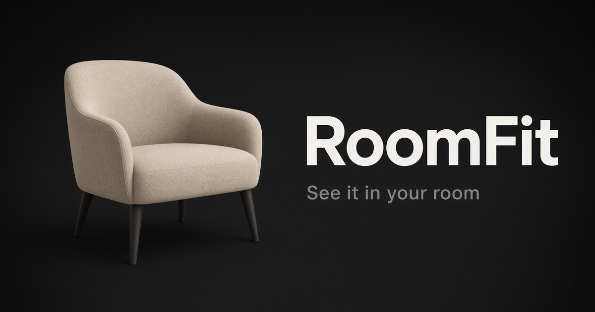
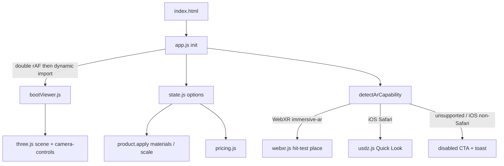

# RoomFit

Browser-based 3D furniture configurator with WebXR / Quick Look AR.

By [Barkah Mauludi](https://barkahmauludi.com).



**Live demo:** [https://roomfit.barkahmauludi.com](https://roomfit.barkahmauludi.com)

## Features

- Switch between armchair and sofa (Poly Haven CC0 models)
- Six fabric colors, fabric/leather finish, and size scale
- Illustrative pricing in IDR or USD (follows UI language)
- Save up to 10 looks in the browser (`localStorage`)
- Screenshot download; Web Share on mobile when available
- **View in your room** AR: WebXR hit-test on Android Chrome; USDZ Quick Look on iOS Safari
- Short first-visit onboarding; English / Indonesian UI
- About modal with credits and illustrative-price disclaimer

## Tech stack

- Vanilla JavaScript (ES modules), [three.js](https://threejs.org/), [Vite](https://vitejs.dev/)
- WebXR immersive-ar + hit-test; `USDZExporter` (`quickLookCompatible`) for Quick Look
- [`camera-controls`](https://github.com/yomotsu/camera-controls), Draco-compressed GLB + WebP textures
- [`pure-web-bottom-sheet`](https://github.com/viliket/pure-web-bottom-sheet) with CSS scroll-snap fallback
- [`motion/mini`](https://motion.dev/), [`@floating-ui/dom`](https://floating-ui.com/), [`driver.js`](https://driverjs.com/) (lazy)
- CI (GitHub Actions): `lint`, `test`, `build`

## Architecture

One full-bleed WebGL canvas. Configuration state lives in memory and mirrors to `localStorage`. AR is a temporary mode on the same renderer (WebXR) or a one-shot USDZ export — not a separate app.



See [docs/ARCHITECTURE.md](docs/ARCHITECTURE.md) for module boundaries, sheet strategy, and fallbacks.

### Technical choices

- **Deferred boot:** after a double `requestAnimationFrame` so the HTML shell paints first, `bootViewer` is loaded with `import()` (`src/core/app.js`, `src/scene/bootViewer.js`).
- **Lazy AR:** `src/ar/webxr.js` and `src/ar/usdz.js` are `import()`’d when the AR CTA needs them — they are not on the initial critical path.
- **Capability:** WebXR `immersive-ar` wins when supported; otherwise iOS Safari → Quick Look; iOS non-Safari asks the user to open Safari; everything else keeps a disabled CTA + toast (`src/ar/capability.js`).
- **WebXR place:** `requestSession('immersive-ar', { requiredFeatures: ['hit-test'] })`, hit-test source on viewer space, reticle from hit results, tap places the product root. `applyHitPose` copies position/rotation from the hit matrix and applies the studio uniform scale (does not inherit XR matrix scale) (`src/ar/webxr.js`).
- **Quick Look:** bake `material.color × map` into a canvas texture, export with `USDZExporter` `{ quickLookCompatible: true }`, open via `<a rel="ar">` (`src/ar/usdz.js`).
- **Mobile performance:** pixel ratio capped at 1.5 off desktop rail; Hemisphere + Directional on mobile (RoomEnvironment / PMREM on desktop only); self-hosted DM Sans; Vite `manualChunks` / named three.js imports; armchair ~391 KB / sofa ~183 KB (Draco + WebP).
- **Layout:** native bottom sheet or CSS scroll-snap fallback on phone; desktop ≥768px uses a right rail (short landscape stays on the sheet).

## Run locally

Requires **Node.js 22+**.

```bash
npm ci
npm run dev
```

Useful scripts:

| Command | Purpose |
|---|---|
| `npm test` | Vitest unit tests |
| `npm run lint` | ESLint |
| `npm run build` | Production build → `dist/` |
| `npm run preview` | Preview the build |
| `npm run e2e` | Playwright smoke (optional; Chromium) |

## License

Code: [MIT](LICENSE) © 2026 Barkah Mauludi.

3D models: [ArmChair_01](https://polyhaven.com/a/ArmChair_01) and [Sofa_01](https://polyhaven.com/a/Sofa_01) by [Poly Haven](https://polyhaven.com/license) (**CC0**). UI icons: individual [Lucide](https://lucide.dev) SVGs (**ISC**). Font: DM Sans (**SIL OFL**), self-hosted under `public/fonts/`.

## Demo limits

- Prices are **illustrative** — this is a portfolio demo, not a store.
- WebXR hit-test and Quick Look need a real device, a compatible browser, and **HTTPS**.
- Saved looks stay in the browser (`localStorage`); there is no backend or account.
